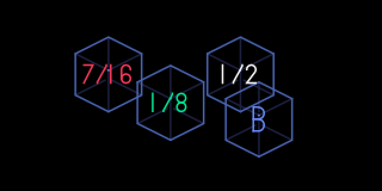
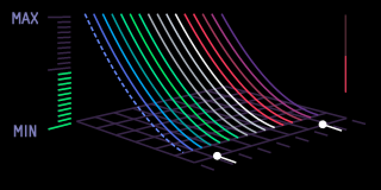
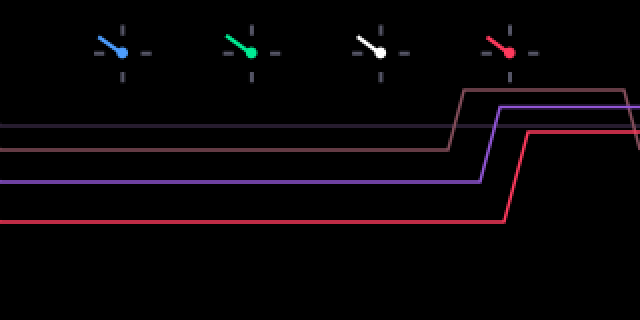
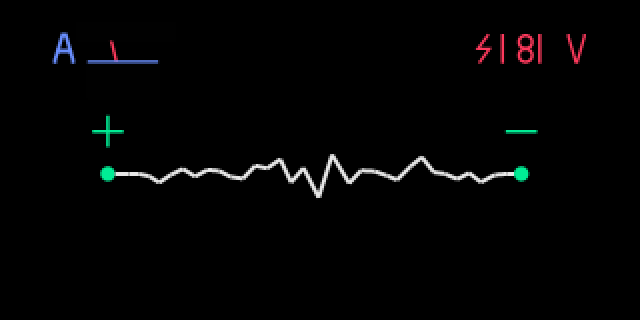
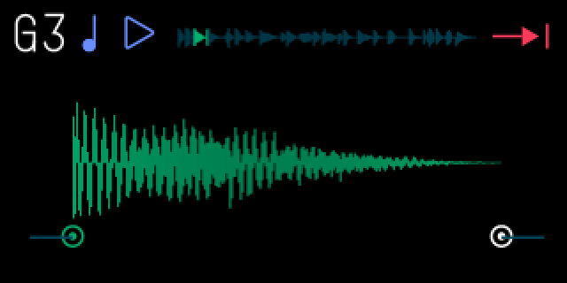
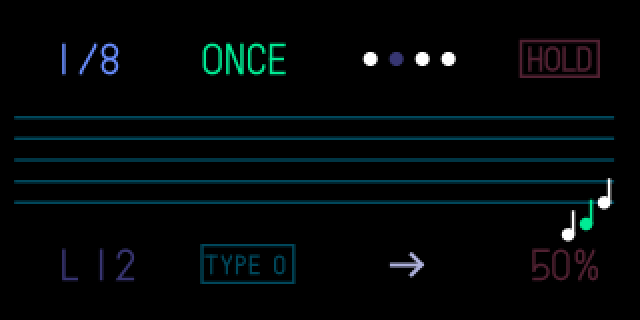
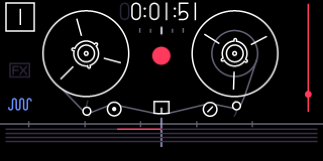

# opi1: a native OP-1 (OG) for Linux

A native, low-latency re-implementation of the original Teenage Engineering OP-1 (firmware R.00246) in C++20,
for Linux desktops and small Linux boards. It plays through ALSA or PipeWire, takes MIDI in and out, and draws
the original screens.

**This repository contains no Teenage Engineering firmware, samples, graphics, fonts or presets, and no
binaries.** The screens, the font and the factory presets and kits are read at run time from **your own** OP-1
OG firmware image (`op1_246.op1`). Without one the app still runs and plays its synth engines, but the screens
stay blank and the drum kits and sampler have nothing to play.

| | | |
|---|---|---|
|  |  |  |
|  |  |  |
|  | | |

## What works

- All 12 OG synth engines (fm, digital, dr wave, string, cluster, pulse, sampler, phase, dna, dsynth, voltage,
  iter), drum (14 factory kits) and dbox, 8 effects, 7 LFOs, envelope and play modes.
- The 6 sequencers (finger, pattern, sketch, arpeggio, endless, tombola), tempo, metronome, MIDI clock.
- 4-track tape: record (replace or overdub), the recorded line drawn live, play, reverse, speed, loop,
  lift/drop, split/join, tape tricks.
- Mixer, master effect, volume.
- The preset browser with the factory presets (browsing previews them; an encoder push keeps one on its slot).
- Every OP-1 panel control on the PC keyboard, laid out like the device (`KEYMAP.md`).

The DSP is a behavioural re-implementation, not a bit-exact copy. Parameter ranges, knob decodings and many
screen behaviours follow the firmware.

## Build

Ubuntu 24.04 or newer (anything with CMake ≥ 3.20, a C++20 compiler, `libasound2` and SDL3 should work).

```sh
sudo apt install build-essential cmake pkg-config libasound2t64 libsdl3-0   # runtime libraries
./build.sh              # Release build -> build/op1-og
./build.sh test         # build and run all tests (ctest)
./build.sh sanitize     # AddressSanitizer + UBSan build and tests in build-sanitize/
```

`build.sh` needs no root for the headers: `sys/setup.sh` downloads the ALSA and SDL3 development packages
that match your installed runtime libraries and unpacks them into `sys/` (gitignored).

## Firmware image

Put your OG firmware image in `./firmware/` (for example `firmware/op1_246.op1`), or pass it with
`--firmware PATH` or the `OP1_OG_FIRMWARE` environment variable. It is opened read-only. The `firmware/` folder is
gitignored. Never commit the image.

## Run

```sh
./run.sh                 # builds if needed, opens the window on your desktop session (also from SSH)
./run.sh --keyboard      # plus an on-screen keyboard and the key-map legend
./run.sh --device hw:1,0 # pick the audio device: pipewire (default on a desktop), default, hw:X,Y, none, wav:FILE
./run.sh --help
```

Audio defaults to PipeWire on a desktop session (the output chosen in the sound settings), with a short quantum.
`--device hw:X,Y` gives direct ALSA with the lowest latency. `--device wav:out.wav` renders to a file.

## Keys (short)

The PC keyboard is mapped by physical key position (any layout). The full map is in `KEYMAP.md`.

| OP-1 | PC |
|---|---|
| encoders blue, green, white, orange | push F1-F4; turn F5/F6, F7/F8, F9/F10, F11/F12 (Ctrl = 8 steps) |
| help, synth, drum, tape, mixer, tempo | `` ` `` 1 2 3 4 5 |
| T1-T4 | Q W E R |
| lift, drop, split | A S D |
| record, play, stop | Z X C. Shift+Z = overdub. Hold Z (or arm it) and play a note to start recording |
| octave / tape left, right | Left/Right arrows |
| 24 keys F..E | V B N M , . / (black G H J L ;) and T Y U I O P [ (black 6 7 8 0 -) |
| sound keys 1-8 | Ctrl+1..8 or keypad 1-8; with Shift: the preset browser for that slot |
| volume, power | PageUp/PageDown, End |

## Scripted runs and screenshots

```sh
build/op1-og --firmware FW --device none --no-window \
  --ui-script "op=tape,op=play,press=blue,wait=1000,shot=tape.png,quit"
```

Steps and key names are in `src/gui/ui_input.h`. Screenshots you take contain artwork rendered from your
firmware image, so keep them to yourself.

## Layout

| path | what |
|---|---|
| `include/op1/` | shared interfaces: messages, snapshot, core, dsp, tape, sequencer, io, ui |
| `src/core`, `src/platform`, `src/app` | audio graph and queues, ALSA/PipeWire backend, `main` |
| `src/dsp` | synth and drum engines, voices, envelopes, effects, LFOs |
| `src/tape`, `src/seq`, `src/midi`, `src/state` | tape and mixer, sequencers and tempo, MIDI, preset/sample worker |
| `src/gui`, `src/assets` | screens (SVG from the firmware image), input mapping, firmware asset reader |
| `tests/` | ctest suites (DSP, GUI, keys, MIDI, sequencers, presets, tape) |
| `spikes/` | the Rust vs C++ latency spikes that chose the language |

## Not affiliated

OP-1 is a trademark of Teenage Engineering AB. This project is not affiliated with or endorsed by Teenage
Engineering. It reads the firmware you own; it does not distribute it.
